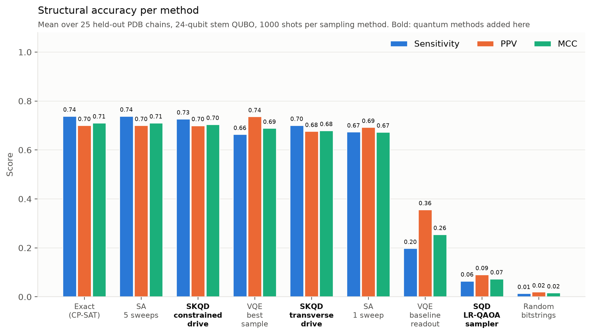

# mRNA-QD-expansion

RNA secondary structure prediction as a stem QUBO, tested on experimental PDB structures, with
sample-based quantum diagonalisation (SQD) and sample-based Krylov quantum diagonalisation (SKQD)
added as solvers. It extends [WISER-Moderna](https://github.com/Nox-eturnus/WISER-Moderna), which
used self-generated target structures.

A short project report is in [report/project_report.pdf](report/project_report.pdf).

## What is new

- Targets are 792 RNA chains from the PDB (BGSU non-redundant list, base pairs from FR3D), split by
  RNA family into a calibration fold (317) and a test fold (475).
- Stem candidates include truncations of maximal stems. This lifts the best reachable MCC from
  0.767 to 0.954.
- The energy model (M3) uses exact two-stem Turner corrections only where they are valid. Its exact
  optimum reaches MCC 0.775 on the test fold, against 0.713 for the original QUBO, 0.792 for
  ViennaRNA and 0.771 for pKiss.
- SKQD (transverse and constrained drives) and SQD with a linear-ramp QAOA sampler, simulated
  exactly at 24 to 28 qubits, with a Pauli-trajectory noise model and gate counts for all-to-all and
  heavy-hex devices.

## Results

25 held-out chains, 24 qubits, 1000 shots, same Hamiltonian for every method:



| method | MCC | finds the optimum |
|---|---|---|
| Exact (CP-SAT) | 0.711 | 100 % |
| SKQD, constrained drive | 0.705 | 90 % |
| SKQD, transverse drive | 0.680 | 82 % |
| VQE, original readout | 0.255 | 4 % |
| SQD, LR-QAOA sampler | 0.074 | 1 % |
| Simulated annealing, 5 sweeps | 0.711 | 100 % |

More tables are in [report/tables.md](report/tables.md).

## Setup

```bash
micromamba create -n mrna-sqd -c conda-forge -c bioconda python=3.12 viennarna
micromamba activate mrna-sqd
pip install -r requirements.txt
git clone https://github.com/Nox-eturnus/WISER-Moderna
```

The WISER-Moderna clone goes in the repository root. Its code provides the original QUBO (M0) and is
used by the tests. pKiss is only needed for `scripts/classical_baselines.py` and is called from a
separate environment named `pk-tools`.

## Running

All results are already in `results/`, so the report scripts work without rerunning anything.

```bash
python -m pytest tests/
python scripts/build_pdb_dataset.py      # rebuild data/ (needs network access)
python scripts/census.py                 # folds, encodings, reachable MCC
bash scripts/run_test_fold.sh            # exact optimum of each model on the test fold
bash scripts/run_qset.sh                 # SQD, SKQD and controls on 100 test chains
bash scripts/run_noise_vqe_scaling.sh    # noise, VQE, 26 and 28 qubits
bash scripts/run_method_comparison.sh    # all methods on the 25 matched chains
python scripts/make_report.py            # report/tables.md and figures
python scripts/method_bars.py            # method comparison figure
```

The shell scripts take the interpreter from `$PY` (default `~/micromamba/envs/mrna-sqd/bin/python`).
The Q-set runs take several hours on a 32-thread machine.

## Layout

- `mrnasqd/`: dataset builder, stem encodings, QUBO models and CP-SAT solver (`qubo_v2.py`),
  statevector simulation (`quantum.py`), SQD and SKQD sampling and post-processing (`sqd.py`)
- `scripts/`, `jobs/`: experiment drivers and job lists
- `data/`: chains, folds and the quantum benchmark sets
- `results/`: raw results (JSON lines) and summaries
- `report/`: project report, tables and figures
